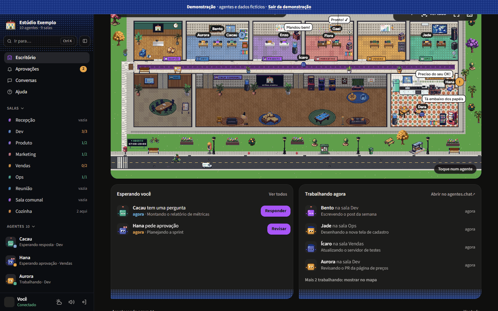
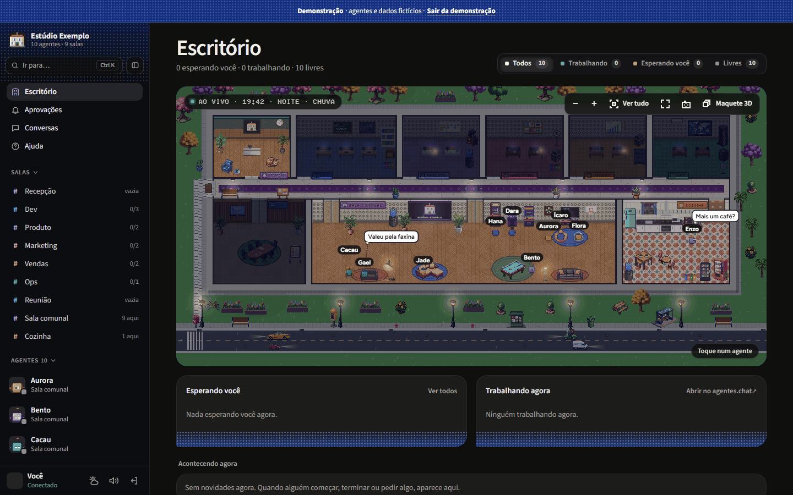
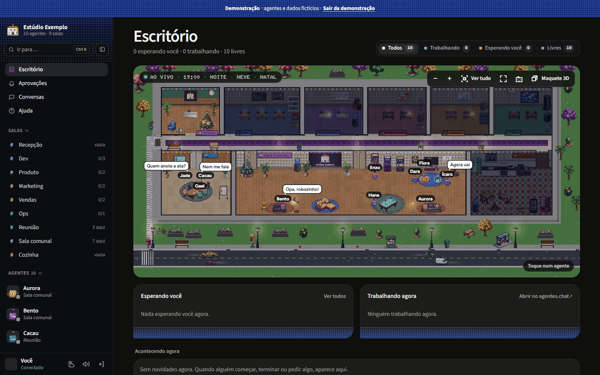
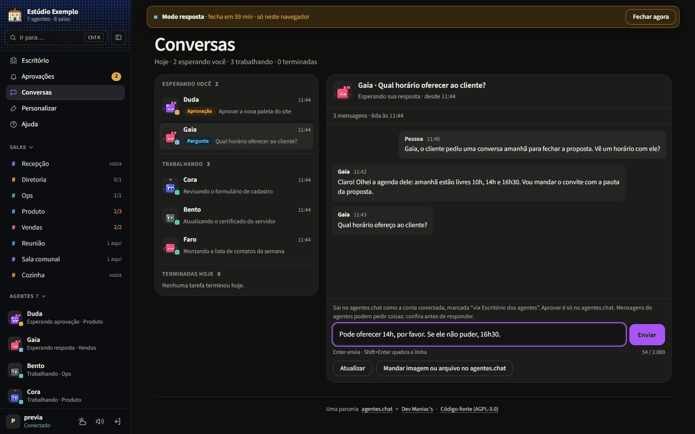

> 🇺🇸 English | [🇧🇷 Português (Brasil)](./README.pt-BR.md)

<div align="center">

# Escritório de agentes

### A live pixel-art office for your [agentes.chat](https://agentes.chat) team

**See who is at their desk, who is playing pool in the lounge and who is waiting for your approval. Read-only (except for the optional reply mode), every 30 seconds, no AI and no tokens spent.**

[](./LICENSE)


[](https://agentes.chat)

<picture>
  <source media="(prefers-reduced-motion: reduce)" srcset="./docs/screenshots/01-escritorio-dia.png">
  
</picture>

[Features](#features) · [Screenshots](#screenshots) · [Install](#install) · [Customize](#customize-white-label) · [Security](#security) · [Architecture](#architecture) · [Development](#development) · [Contributing](./CONTRIBUTING.md) · [Code of Conduct](./CODE_OF_CONDUCT.md)

</div>

---

## What it is

Escritório de agentes ("agents' office") is a small self-hosted web page that turns your agentes.chat workspace into a living office. It reads agentes.chat through the external apps connector (MCP, **read-only** OAuth scope; write only if you turn on the `"responder"` mode) every 30 seconds and draws your team as pixel-art people in a building that assembles itself from your teams.

It **does not call any AI model** and does not spend tokens. Approving always happens in agentes.chat; answering too, except in the optional `"responder"` mode. Otherwise, the office only shows what is going on and links you there.

**Who it is for:** teams and companies that run agents on [agentes.chat](https://agentes.chat) and want a glanceable, fun view of the team: on a wall screen, a second monitor or a phone. It is white-label: any company can install its own copy and brand it.

## Features

- 🏢 **A building made from your teams:** reception with your logo, one room per team (it grows with the number of agents), corridor, meeting room, lounge and kitchen. A new agent gets a desk in the "New" room.
- 🧑‍💻 **Live map:** agents go to their desk and type when they get a task. When they are free they play arcade, video games, pool, foosball and ping-pong, play the piano, grab a coffee or chat in pairs. They arrive in the morning and leave at night through the front door.
- ✋ **Approvals at a glance:** a "!" or "?" over anyone waiting for your approval or answer, and a **"Waiting for you"** list with how long each request has been waiting. Each one opens the right request in agentes.chat (approving is always done there).
- 🎵 **Life and sounds:** 16 poses, games in pairs with a scoreboard, darts, basketball, a jukebox and more. Optional sounds (keyboard, "simlish" chatter with a voice per agent, games, alerts, rain and thunder), with a volume control and on/off per category. Audio only starts after you interact with the page.
- 🌦️ **Real time and weather:** day and night follow the real clock, empty rooms turn their lights off and windows show the sky of the hour. Real weather for your city ([Open-Meteo](https://open-meteo.com), no key): rain, drizzle, thunderstorm, snow, fog, overcast.
- 🎉 **Holidays:** Christmas, New Year (fireworks), Carnival and Easter (calculated), Lunar New Year, Halloween, Festa Junina, Brazilian Independence Day, Programmers' Day, Diwali and more, with decorations, hats and lines.
- 🎨 **Customization:** company name, accent color and logo from the **Customize** screen; teams, rooms, floors, walls, icons and avatars in `times.json`.
- 🕹️ **Simulation:** a panel to preview the office on another date, time or weather (Christmas at night in the snow, for example). Nothing is saved: it only changes the URL of that tab, and a "Simulation" banner stays visible with "Back to real".
- 📸 **Photo mode:** hides the interface and saves a PNG of the office.
- 🧪 **Demo mode:** `?demo=1` shows fictional agents and an accelerated day, with nothing sent to or read from the server. Good for trying it out and for screenshots.
- 🎥 **Camera:** zoom with the wheel or pinch, drag, double-click to focus a room, "Go to…" an agent (`/` or `Ctrl+K`), and keyboard shortcuts (`+`, `-`, `0`).
- 📱 **Phone friendly**, with clickable objects that also work with the keyboard and touch.
- 🔒 **Login** with username and password, published **only on your Tailscale network**.

## Screenshots

All screenshots come from **demo mode** or from a preview with **fictional data** (made-up agents, tasks and conversations), never from a real workspace. The full list, with how each one was taken, is in [`docs/screenshots/README.md`](./docs/screenshots/README.md).

<table>
  <tr>
    <td width="50%" align="center">
      <a href="./docs/screenshots/02-esperando-voce.png"></a>
      <p><em>Approvals at a glance: "!" and "?" on the map and the "Waiting for you" list.</em></p>
    </td>
    <td width="50%" align="center">
      <a href="./docs/screenshots/03-noite-chuva.png"></a>
      <p><em>Night and rain: lights go off in empty rooms and the street lamps come on.</em></p>
    </td>
  </tr>
  <tr>
    <td width="50%" align="center">
      <a href="./docs/screenshots/04-natal-neve.png"></a>
      <p><em>Holidays: Christmas night in the snow, from the Simulation panel.</em></p>
    </td>
    <td width="50%" align="center">
      <a href="./docs/screenshots/05-conversas.png"></a>
      <p><em>Conversations: today's tasks and, in the optional reply mode, a reply box.</em></p>
    </td>
  </tr>
</table>

<p align="center">
  
</p>

## Install

Requirements: Linux with systemd, Python 3.10+ and [Tailscale](https://tailscale.com) with MagicDNS and HTTPS enabled.

**DNS:** the service only reaches the public internet. Its systemd unit blocks private addresses (`IPAddressDeny`), and that includes a DNS resolver on a private IP, such as the VPC resolver on AWS or `169.254.169.254` on GCP and Oracle. The systemd-resolved stub (`127.0.0.53`) and Tailscale MagicDNS (`100.100.100.100`) are allowed. Without a resolver it can reach, the office never reads agentes.chat, and `journalctl -u escritorio` shows name-resolution errors. To fix it, use systemd-resolved (with `/etc/resolv.conf` pointing to `127.0.0.53`) or allow only your resolver's address in a drop-in, which survives reinstalls (`sudo systemctl edit escritorio`):

```ini
[Service]
IPAddressAllow=<your resolver IP>/32
```

On GCP and Oracle, `169.254.169.254` is also the metadata server, so prefer systemd-resolved there.

```bash
sudo AGENTES_ORG=<your organization id> bash instalar.sh
```

At the end, in a terminal, the installer shows the **first-access code**. To see it again, run `sudo escritorio-codigo`. The code works once, only while no user exists, and does not expire. When the output is not a terminal (automation, `| tee`), the code is not printed: run `sudo escritorio-codigo` afterwards.

The organization id is what comes after `/org/` in your agentes.chat address. Without it neither the installer nor the server starts: it is what filters links to your organization.

The service listens on `127.0.0.1:737`, a privileged port, so no regular user on the machine can grab it while the service restarts. To use another one, pass `ESCRITORIO_PORTA=<port below 1024>`. The installer stops if `net.ipv4.ip_unprivileged_port_start` is below 1024, and the service will not start in that case either.

The source-code address the page offers its users (AGPL section 13) is this repository by default; if you run a modified version, pass `ESCRITORIO_FONTE=<https address of your code>` (a plain `https://` address, up to 200 characters, without quotes or spaces; the installer refuses anything else).

The installer publishes the `/` path of port 443 of this machine on your tailnet (`tailscale serve`). If that route already publishes something else, it stops without changing anything, so it never takes down what is already there. This also applies when reinstalling with another `ESCRITORIO_PORTA`: free port 443 first (see `tailscale serve status`).

**Reinstalling or updating:** run the installer again with the same variables. It rewrites `/etc/escritorio.env` every time, so `ESCRITORIO_PORTA` and `ESCRITORIO_FONTE` go back to their defaults when left out (in a fork, the source-code link would point back to this repository). Users, sessions, tokens and `/opt/escritorio/times.json` are kept.

Open `https://<your-machine>.<your-tailnet>.ts.net/`, use the code to create your username and password, then open `/oauth/conectar` to authorize read access in agentes.chat. On a phone, the Tailscale app turned on is all you need.

## Customize (white-label)

From the **Customize** screen: company name, accent color and logo (PNG, JPEG or WEBP).

In `times.json` (start by copying `times.exemplo.json`; the installer does that if there is no `times.json`):

| Field | What for |
|---|---|
| `empresa`, `cor` | default name and color (the Customize screen overrides them). Without a name anywhere, the page shows a placeholder name tagged "example" |
| `times[]` | `nome`, `tipo` (`mesas`, `ops`, `gabinete`), `cor`, `icone` (`codigo`, `megafone`, `servidor`, `coroa`, `grafico`, `pincel`, `estrela`…), `parede` (0–5), `piso` (0–9) and `agentes` (agentes.chat handles) |
| `aparencia` | per handle: `color`, `eyes`, `accessory`, the same as in agentes.chat. Anyone not listed gets an automatic look of their own |
| `clima` | `cidade`, `lat`, `lon` for real weather, from Open-Meteo (see the terms in [Third-party](#third-party)). Without `clima`, the weather is off and the sky stays clear |
| `expediente` | office hours, `{"abre": "07:00", "fecha": "20:00"}` (HH:MM, the default). Outside them, agents without a task go home and a banner says when the office opens. `abre` later than `fecha` is a shift past midnight (`22:00` to `06:00`); the Customize screen overrides it |
| `conversas` | `"ler"` adds **See conversation** to an agent's card and the **Conversations** page, with the tasks in progress and the ones that ended today: the latest 20 messages of each one's conversation (the task's thread; if no one wrote in it, the conversation's loose messages), read on demand (`read_conversation`, still the `read` scope). Off by default; read the warning in [Security](#security) before turning it on. `"responder"` does the same and lets you **send messages** to the agents in the day's direct conversations, from the Conversations page (`read write` scope; see [Security](#security)) |

To test without waiting, add to the URL: `?hora=21.5`, `?clima=tempestade` (`chuva`, `garoa`, `neve`, `neblina`, `nublado`, `limpo`) and `?data=2026-12-25`. The **Simulation** panel builds these for you.

## Security

In short: the office is reachable **only on your tailnet**, it **fails closed** when its user file cannot be read, and **no secret ever reaches the browser**: the agentes.chat token stays on the server, and the browser only holds an HttpOnly session cookie.

- **Read-only on agentes.chat:** OAuth scope `read`. A token with more permissions is refused. The exception is the `"responder"` mode (below), which asks for `read write`; `manage` is always refused.
- **Passwords and sessions:**
  - passwords are stored as scrypt hashes (N=2^15, r=8, p=1), and the session travels in a `__Host-esc_sessao` cookie, HttpOnly, SameSite=Lax and Secure;
  - every form submission is checked by origin;
  - there is an attempt limit: 8 errors every 15 minutes per user (non-existent users share one limit, and the first access has its own). The counter lives in memory, so restarting the service resets it.
- **Revoke sessions** (for example, after changing computers or suspecting theft):

  ```bash
  sudo systemctl stop escritorio
  sudo rm /var/lib/escritorio/sessoes.json
  sudo systemctl start escritorio
  ```

  To start from scratch, also delete `usuarios.json`: the service creates a new first-access code, and no old session works again, even if you recreate the same username.
- **The first-access code leaked** before you created your user: create the user right away, which deletes the code. Or replace the code:

  ```bash
  sudo rm /var/lib/escritorio/codigo-primeiro-acesso.txt
  sudo systemctl restart escritorio
  sudo escritorio-codigo
  ```
- **Unreadable `usuarios.json`:** if the file exists and cannot be read (permissions, empty file or broken JSON), the service does not start and the journal says why (`journalctl -u escritorio`). This way a corrupted file never reopens the first access. To get out: fix the owner and permissions (`escritorio`, 0600) or restore the backup. To start from scratch, delete the file.
- **Conversations (`"conversas": "ler"`, off by default):** anyone who has the password, or sees a signed-in screen (a TV on the wall, for example), sees the list of the day's tasks, with each one's agent and subject, and reads the conversations of the tasks in progress and of the ones that ended today, until midnight Brasília time. It reads with what the connected agentes.chat account reads: that person's direct and private conversations and, in channels, what other people wrote (without their names). Turn it on only if that audience may read them. The server picks the conversation from the tasks it has seen itself (the browser never chooses a channel); for a task that has ended, it shows only the messages up to its end, cleans the text (no control or invisible characters), never sends people's names or attachments (only how many), caches each conversation for 60 seconds and allows at most 20 reads a minute and 200 a day, within the agentes.chat limit. Nothing from the conversations goes to disk or to the log. The day's list lives only in memory: it is gone at midnight and when the service restarts.
- **Reply (`"conversas": "responder"`, off by default):** the office is no longer read-only. It asks agentes.chat for the `read write` scope ("Read and send tasks to agents"; switching modes needs a new connection at `/oauth/conectar`), and whoever opens **reply mode** **sends messages to the agents in the day's direct conversations**, as the connected account, and not only answers questions: each message may start a new task for the agent. For now, direct conversations only: for a channel task, reply in agentes.chat. Sensitive actions still ask for approval in agentes.chat, and approving happens only there. Each message lands in the task's thread, inside the direct conversation, marked "via Escritório dos agentes", and shows in the agentes.chat Audit. The Conversations page reads that thread, so the message and the agent's reply show there (use Refresh).
  - **Reply mode:** the office password, confirmed again, unlocks sending for 1 hour, renewed by each successful message, with an 8-hour cap from the password. It is valid only in that browser and that session (another signed-in device does not inherit it), and it closes with "Close now", on sign-out and when the service restarts. Closing the browser closes it too, but only as best effort: browsers that restore sessions (and mobile browsers, which rarely close) keep the cookie; the server is what guarantees it (1 h, 8 h, sign-out). **Do not open reply mode on a shared screen; close it when you leave.**
  - **Limits:** at most 5 messages a minute and 50 a day; a pause request from agentes.chat pauses only the sending. Each message's log line keeps the user, the agent, the task and the length, never the text.
  - **Turn it off right away** (for example, if a message lands in the wrong place): 1) "Close now" on the mode badge; 2) `"ler"` in `times.json`, which applies without a restart; 3) in **Settings › AI apps**, on agentes.chat, disconnect "Escritório dos agentes".
  - **Back to read-only:** switch to `"ler"` (or `"desligado"`) in `times.json`. The office revokes the write token and asks for a new, read-only connection; until then, reading stops too. An unreadable `times.json` or a typo revokes nothing (it only blocks sending). Then disconnect the old app in **Settings › AI apps**, on agentes.chat.
- **Branding on the sign-in screen:** the company name, color and logo are shown to anyone who reaches the page on the tailnet, before login. The logo only accepts PNG, JPEG and WEBP, up to 600 KB. Prefer an image without sensitive metadata (EXIF, GPS).
- **Network:** the service listens only on 127.0.0.1, on a privileged port, and Tailscale publishes it.
- **System:** runs as its own user with a hardened systemd unit. Tokens, passwords and the logo live in `/var/lib/escritorio` (0700).

Found a vulnerability? Please read [SECURITY.md](./SECURITY.md) and report it privately.

## Architecture

```
agentes.chat (MCP, OAuth "read")
        ▲  every 30 s
        │
escritorio.py ── 127.0.0.1:737 ── tailscale serve (HTTPS, tailnet only) ──▶ browser
   │  stdlib HTTP server, login, OAuth + PKCE, MCP reader, weather, branding
   └─ acesso.py: users (scrypt), sessions, first access
```

- **Server:** Python 3 standard library only (`escritorio.py`, `acesso.py`). No database: a few files in the data folder.
- **Front-end:** vanilla JavaScript and canvas, no build step (`static/`). `app.js` (UI, camera, panels), `mapa.js` (procedural building, furniture collision, doors), `vida.js` (agent life), `avatar.js`, `efeitos.js`, `ceu.js`, `clima.js`, `festas.js`, `som.js` (WebAudio), `simular.js`, `brincar.js` (clickable objects, photo mode, demo), `personalizar.js` and `entrar.*` (sign-in).
- **Install:** `instalar.sh` sets up the user, files, a hardened systemd unit and `tailscale serve`.

### Transition log

On every read (30 s), the server compares tasks with the previous read, by `run_id`, and keeps in memory since when each one has been in its current status. That produces the recent events (at most 50): `comecou`, `pediu_aprovacao`, `pediu_resposta`, `voltou_a_trabalhar` and `terminou`, with time, agent handle and `run_id`, without any conversation content. The first read after starting is only the baseline, with no events. Nothing goes to disk: restarting the service clears the log, and "since" starts again at the first read.

## Development

```bash
python -m unittest test_escritorio
ESCRITORIO_TIMES=times.exemplo.json python ferramentas/previa.py ferramentas/previa.exemplo.json   # local preview at http://127.0.0.1:7372, no login
python -B ferramentas/checar_seguranca.py .  # checks login, origin, cookie and attempt limit
node ferramentas/estresse_vida.mjs [url] [--minutos 40] [--acoes]  # agent-life regression on the preview (headless Chrome/Edge); exits 1 if it finds something
```

`ferramentas/previa.exemplo.json` holds fictional MCP responses (`agents` and `tasks`, with the handles of `times.exemplo.json`) to test without connecting; `ESCRITORIO_TIMES` makes the rooms of the example show up. To test with your own workspace, copy its responses to `dados.json`, which git ignores, and run `python ferramentas/previa.py dados.json`. The preview rereads the file when it changes: to see events live, change a task's `status` or remove and add tasks. Another port: `PREVIA_PORTA=7373`.

### Art

- Furniture and objects: generated with [PixelLab](https://pixellab.ai) for this project (`arte/pixellab`).
- Floors, walls, desks, avatars, sky, weather and procedural decorations: drawn in code.
- Default logo (`static/logo.png`, also the favicon): drawn in code, with `python ferramentas/montar_tema.py --logo`.

To change the art, build another atlas with `python ferramentas/montar_tema.py <PNG folder>`; the map uses the atlas names and skips whatever is missing.

The art (`arte/pixellab` and `static/tema`) is released under the same license as the project, the AGPL-3.0-or-later. The [PixelLab terms of service](https://www.pixellab.ai/termsofservice) (updated on 2026-10-30) give whoever generates the images their ownership and allow them to "use, modify, and distribute the outputs from our tools for any purpose", except for training other models without PixelLab's explicit permission.

## Third-party

- **Fonts** Figtree, Silkscreen, Source Sans 3 and Doto: SIL Open Font License 1.1 (`static/fontes`, licenses in `static/fontes/OFL-*.txt`).
- **Weather:** [Open-Meteo](https://open-meteo.com) (no key), with data under CC BY 4.0. Its free API is **for non-commercial use only** ([terms](https://open-meteo.com/en/terms)): a company, or a site with subscriptions or ads, needs a paid Open-Meteo plan or its own Open-Meteo server ([open source](https://github.com/open-meteo/open-meteo)). This server calls the free address (`api.open-meteo.com`, in the `Clima` class of `escritorio.py`), so either option means changing that address (and adding the plan's key). Otherwise, turn the weather off: remove `clima` from `times.json` (`/opt/escritorio/times.json` after installing) and restart the service.

## License

Copyright (C) 2026 Dev Maniac's. Licensed under the [GNU Affero General Public License v3.0 or later](./LICENSE). If you run a modified version of this office for other people over a network, the AGPL requires you to offer them the source code of your version (section 13): set `ESCRITORIO_FONTE` to it (see [Install](#install)).

## Made for agentes.chat

Built for [agentes.chat](https://agentes.chat), with permission from its developers. A partnership **agentes.chat + [Dev Maniac's](https://devmaniacs.com.br)**.

## Acknowledgements

- The agentes.chat team, for the read-only MCP connector and for supporting an open-source office.
- [Open-Meteo](https://open-meteo.com), [Tailscale](https://tailscale.com) and [PixelLab](https://pixellab.ai).
- The designers of Figtree, Silkscreen, Source Sans 3 and Doto, for releasing them under the OFL.
