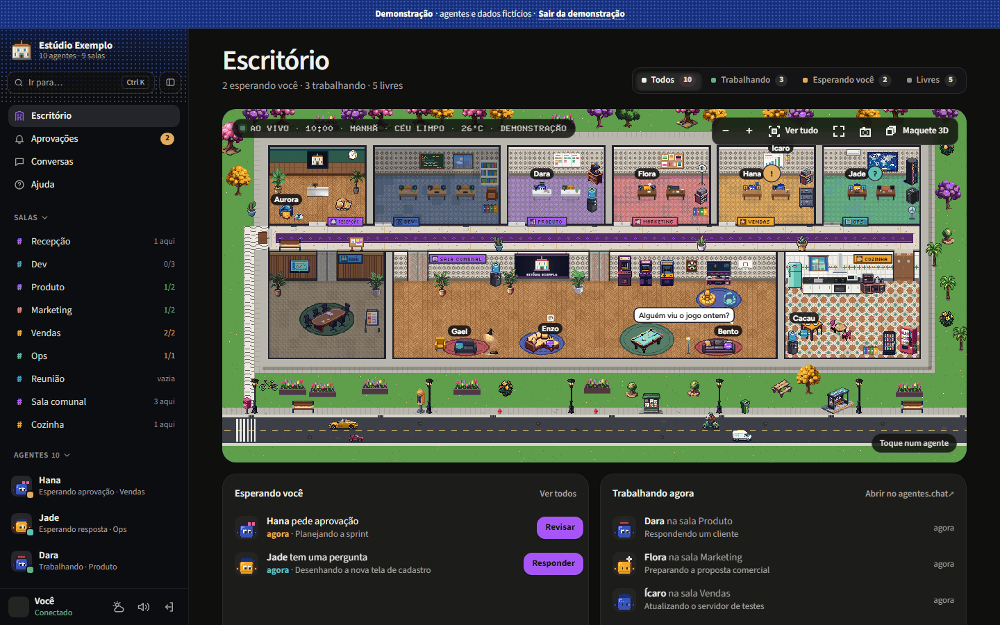
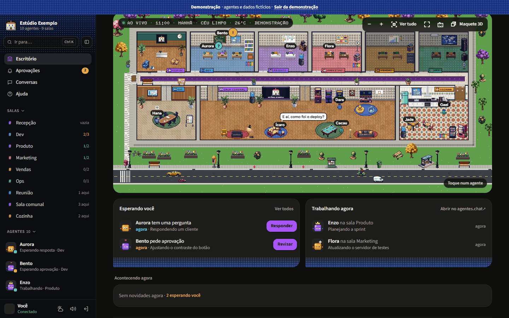
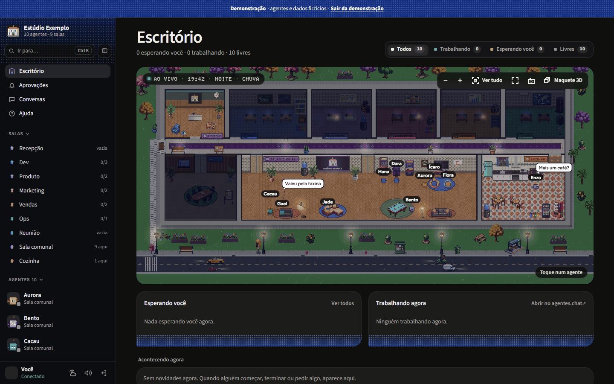
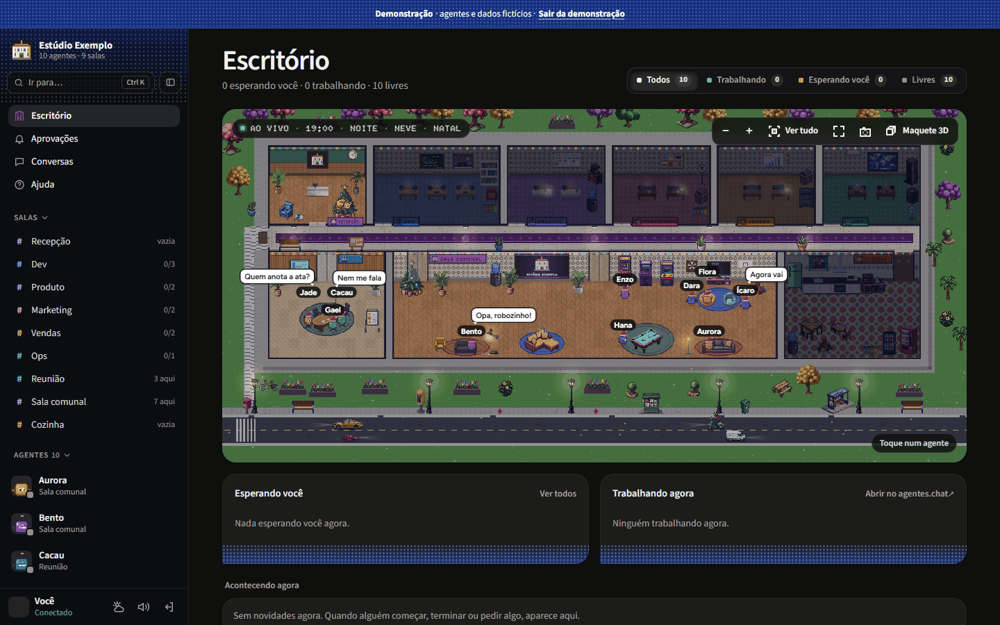
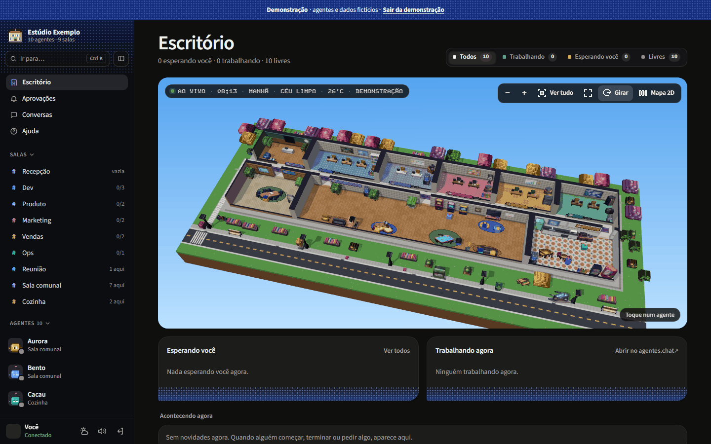
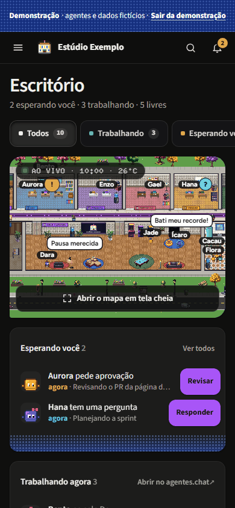

> [🇺🇸 English](./README.md) | 🇧🇷 Português (Brasil)

<div align="center">

# Escritório de agentes

### Um escritório em pixel art, ao vivo, para o seu time do [agentes.chat](https://agentes.chat)

**Veja quem está na mesa, quem joga sinuca na sala comunal e quem espera a sua aprovação. Só leitura, a cada 15 segundos, sem IA e sem gastar tokens.**

[](./LICENSE)


[](https://agentes.chat)



[Recursos](#recursos) · [Capturas](#capturas) · [Instalar](#instalar) · [Personalizar](#personalizar-white-label) · [Segurança](#segurança) · [Arquitetura](#arquitetura) · [Desenvolvimento](#desenvolvimento) · [Contribuir](./CONTRIBUTING.md) · [Código de conduta](./CODE_OF_CONDUCT.md)

</div>

---

## O que é

O Escritório de agentes é uma página web pequena, que você mesmo hospeda, e que transforma o seu workspace do agentes.chat num escritório vivo. Ele lê o agentes.chat pelo conector de apps externos (MCP, escopo OAuth **só de leitura**) a cada 15 segundos e desenha o seu time como pessoas em pixel art, num prédio que se monta sozinho a partir dos seus times.

Ele **não chama nenhum modelo de IA** e não gasta tokens. Aprovar e responder é sempre no agentes.chat: o escritório só mostra o que está acontecendo e leva você até lá.

**Para quem é:** times e empresas que rodam agentes no [agentes.chat](https://agentes.chat) e querem uma visão rápida e divertida do time: numa TV na parede, num segundo monitor ou no celular. É white-label: qualquer empresa instala a sua cópia e põe a própria marca.

## Recursos

- 🏢 **Prédio montado pelos seus times:** recepção com o seu logo, uma sala por time (cresce com o número de agentes), corredor, sala de reunião, sala comunal e cozinha. Agente novo ganha mesa na sala "Novos".
- 🧑‍💻 **Mapa vivo:** os agentes vão para a mesa e digitam quando recebem tarefa. Livres, jogam fliperama, videogame, sinuca, pebolim e pingue-pongue, tocam piano, tomam café ou conversam em dupla. Chegam de manhã e vão embora à noite pela porta da frente.
- ✋ **Aprovações num relance:** um "!" ou "?" sobre quem espera a sua aprovação ou resposta, e a lista **"Esperando você"**, com há quanto tempo cada pedido espera. Cada um abre o pedido certo no agentes.chat (aprovar é sempre lá).
- 🎵 **Vida e sons:** 16 poses, jogos em dupla com placar, dardos, basquete, jukebox e mais. Sons opcionais (teclado, conversas em "simlês" com voz própria por agente, jogos, avisos, chuva e trovão), com volume e liga/desliga por categoria. O áudio só começa depois que você interage com a página.
- 🌦️ **Hora e clima reais:** dia e noite pelo relógio de verdade, luzes que apagam nas salas vazias e janelas com o céu da hora. Clima real da sua cidade ([Open-Meteo](https://open-meteo.com), sem chave): chuva, garoa, tempestade, neve, neblina, nublado.
- 🎉 **Datas comemorativas:** Natal, Ano Novo (fogos), Carnaval e Páscoa (calculados), Ano Novo Chinês, Halloween, Festa Junina, Independência, Dia do Programador, Diwali e mais, com enfeites, chapéus e falas.
- 🎨 **Personalização:** nome da empresa, cor de destaque e logo pela tela **Personalizar**; times, salas, pisos, paredes, ícones e avatares no `times.json`.
- 🕹️ **Simulação:** um painel para ver o escritório em outra data, hora ou clima (Natal à noite na neve, por exemplo). Nada é salvo: muda só o endereço daquela aba, e a faixa "Simulação" fica à vista, com "Voltar ao real".
- 🧊 **Maquete 3D (opcional):** uma visão em voxel do mesmo escritório, feita com three.js e carregada só quando você abre (precisa de WebGL 2; sem ele, o botão nem aparece).
- 📸 **Modo foto:** esconde a interface e salva um PNG do escritório.
- 🧪 **Modo demonstração:** `?demo=1` mostra agentes fictícios e um dia acelerado, sem mandar nem ler nada do servidor. Bom para experimentar e para capturas de tela.
- 🎥 **Câmera:** zoom com a roda ou a pinça, arrastar, duplo clique para focar uma sala, "Ir para…" um agente (`/` ou `Ctrl+K`) e atalhos (`+`, `-`, `0`).
- 📱 **Funciona no celular**, com objetos clicáveis que também respondem ao teclado e ao toque.
- 🔒 **Login** com usuário e senha, publicado **só na sua rede Tailscale**.

## Capturas

Todas as capturas saem do **modo demonstração** (agentes e dados fictícios), nunca de um workspace real. A lista completa, com o jeito de tirar cada uma, está em [`docs/screenshots/README.md`](./docs/screenshots/README.md).

<table>
  <tr>
    <td width="50%" align="center">
      <a href="./docs/screenshots/02-esperando-voce.png"></a>
      <p><em>Aprovações num relance: "!" e "?" no mapa e a lista "Esperando você".</em></p>
    </td>
    <td width="50%" align="center">
      <a href="./docs/screenshots/03-noite-chuva.png"></a>
      <p><em>Noite e chuva: as luzes apagam nas salas vazias e os postes acendem.</em></p>
    </td>
  </tr>
  <tr>
    <td width="50%" align="center">
      <a href="./docs/screenshots/04-natal-neve.png"></a>
      <p><em>Datas comemorativas: noite de Natal na neve, pelo painel de Simulação.</em></p>
    </td>
    <td width="50%" align="center">
      <a href="./docs/screenshots/05-maquete-3d.png"></a>
      <p><em>A maquete 3D opcional, feita com three.js.</em></p>
    </td>
  </tr>
</table>

<p align="center">
  
</p>

## Instalar

Requisitos: Linux com systemd, Python 3.10+ e [Tailscale](https://tailscale.com) com MagicDNS e HTTPS ligados.

**DNS:** o serviço só alcança a internet pública. A unit do systemd bloqueia endereços privados (`IPAddressDeny`), e isso inclui um resolvedor de DNS em IP privado, como o resolvedor da VPC na AWS ou o `169.254.169.254` no GCP e na Oracle. O stub do systemd-resolved (`127.0.0.53`) e o MagicDNS da Tailscale (`100.100.100.100`) são liberados. Sem um resolvedor que ele alcance, o escritório nunca lê o agentes.chat, e o `journalctl -u escritorio` mostra erros de resolução de nome. Para resolver, use o systemd-resolved (com o `/etc/resolv.conf` apontando para `127.0.0.53`) ou libere só o endereço do seu resolvedor num drop-in, que sobrevive às reinstalações (`sudo systemctl edit escritorio`):

```ini
[Service]
IPAddressAllow=<IP do seu resolvedor>/32
```

No GCP e na Oracle, o `169.254.169.254` também é o servidor de metadados; por isso, lá, prefira o systemd-resolved.

```bash
sudo AGENTES_ORG=<id da sua organização> bash instalar.sh
```

No fim, num terminal, o instalador mostra o **código de primeiro acesso**. Para ver de novo, rode `sudo escritorio-codigo`. O código vale uma vez, só enquanto não existe usuário, e não expira. Quando a saída não é um terminal (automação, `| tee`), o código não aparece: rode `sudo escritorio-codigo` depois.

O id da organização é o que vem depois de `/org/` no endereço do agentes.chat. Sem ele o instalador e o servidor não sobem: é ele que filtra os links para a sua organização.

O serviço escuta em `127.0.0.1:737`, uma porta privilegiada, para que nenhum usuário comum da máquina consiga ocupá-la quando o serviço reinicia. Para usar outra, passe `ESCRITORIO_PORTA=<porta abaixo de 1024>`. O instalador para se `net.ipv4.ip_unprivileged_port_start` estiver abaixo de 1024, e o serviço também não sobe nesse caso.

O endereço do código-fonte que a página oferece a quem a usa (AGPL, seção 13) é, por padrão, este repositório; se você roda uma versão modificada, passe `ESCRITORIO_FONTE=<endereço https do seu código>` (um endereço `https://` simples, até 200 caracteres, sem aspas nem espaços; o instalador recusa qualquer outra coisa).

O instalador publica o endereço `/` da porta 443 desta máquina na tailnet (`tailscale serve`). Se essa rota já publica outra coisa, ele para sem mudar nada, para não derrubar o que já existe. Isso vale também ao reinstalar com outra `ESCRITORIO_PORTA`: libere a 443 antes (veja `tailscale serve status`).

**Reinstalar ou atualizar:** rode o instalador de novo com as mesmas variáveis. Ele reescreve o `/etc/escritorio.env` toda vez, então `ESCRITORIO_PORTA` e `ESCRITORIO_FONTE` voltam ao padrão quando ficam de fora (num fork, o link do código-fonte voltaria a apontar para este repositório). Usuários, sessões, tokens e o `/opt/escritorio/times.json` são mantidos.

Abra `https://<sua-máquina>.<sua-tailnet>.ts.net/`, use o código para criar o seu usuário e a senha, e depois abra `/oauth/conectar` para autorizar a leitura no agentes.chat. No celular, basta o app da Tailscale ligado.

## Personalizar (white-label)

Pela tela **Personalizar**: nome da empresa, cor de destaque e logo (PNG, JPEG ou WEBP).

No arquivo `times.json` (comece copiando o `times.exemplo.json`; o instalador faz isso se não houver um `times.json`):

| Campo | Para quê |
|---|---|
| `empresa`, `cor` | nome e cor padrão (a tela Personalizar sobrepõe). Sem nome em lugar nenhum, a página mostra um nome provisório com a etiqueta "exemplo" |
| `times[]` | `nome`, `tipo` (`mesas`, `ops`, `gabinete`), `cor`, `icone` (`codigo`, `megafone`, `servidor`, `coroa`, `grafico`, `pincel`, `estrela`…), `parede` (0–5), `piso` (0–9) e `agentes` (handles do agentes.chat) |
| `aparencia` | por handle: `color`, `eyes`, `accessory`, iguais aos do agentes.chat. Quem não está aqui ganha uma aparência própria automática |
| `clima` | `cidade`, `lat`, `lon` para o clima real, do Open-Meteo (veja os termos em [Terceiros](#terceiros)). Sem `clima`, o clima fica desligado e o céu, limpo |

Para testar sem esperar, use na URL: `?hora=21.5`, `?clima=tempestade` (`chuva`, `garoa`, `neve`, `neblina`, `nublado`, `limpo`), `?data=2026-12-25` e `?visao=maquete` (3D). O painel de **Simulação** monta isso para você.

## Segurança

Em resumo: o escritório só é alcançável **na sua tailnet**, **falha fechado** quando o arquivo de usuários não pode ser lido, e **nenhum segredo chega ao navegador**: o token do agentes.chat fica no servidor, e o navegador só guarda um cookie de sessão HttpOnly.

- **Só leitura no agentes.chat:** escopo OAuth `read`. Um token com mais permissões é recusado.
- **Senhas e sessões:**
  - a senha fica guardada como hash scrypt (N=2^15, r=8, p=1), e a sessão vai num cookie `__Host-esc_sessao`, HttpOnly, SameSite=Lax e Secure;
  - todo envio de formulário é conferido pela origem;
  - há limite de tentativas: 8 erros a cada 15 minutos por usuário (os usuários que não existem dividem um limite só, e o primeiro acesso tem o seu). O contador fica na memória, então reiniciar o serviço o zera.
- **Revogar sessões** (por exemplo, depois de trocar de computador ou de suspeitar de roubo):

  ```bash
  sudo systemctl stop escritorio
  sudo rm /var/lib/escritorio/sessoes.json
  sudo systemctl start escritorio
  ```

  Para recomeçar do zero, apague também `usuarios.json`: o serviço cria um novo código de primeiro acesso, e nenhuma sessão antiga volta a valer, mesmo que você recrie o mesmo nome de usuário.
- **Código de primeiro acesso vazou** antes de você criar o usuário: crie o usuário na hora, o que apaga o código. Ou troque o código:

  ```bash
  sudo rm /var/lib/escritorio/codigo-primeiro-acesso.txt
  sudo systemctl restart escritorio
  sudo escritorio-codigo
  ```
- **`usuarios.json` ilegível:** se o arquivo existir e não puder ser lido (permissão, arquivo vazio ou JSON quebrado), o serviço não sobe e o journal diz o motivo (`journalctl -u escritorio`). Assim um arquivo corrompido nunca reabre o primeiro acesso. Para sair: conserte o dono e a permissão (`escritorio`, 0600) ou restaure o backup. Para recomeçar do zero, apague o arquivo.
- **Marca na tela de entrar:** o nome, a cor e o logo da empresa aparecem para quem alcança a página na tailnet, antes do login. O logo aceita só PNG, JPEG e WEBP, de até 600 KB. Prefira uma imagem sem metadados sensíveis (EXIF, GPS).
- **Rede:** o serviço escuta só em 127.0.0.1, numa porta privilegiada, e quem o publica é a Tailscale.
- **Sistema:** roda com usuário próprio e unit systemd endurecida. Tokens, senhas e logo ficam em `/var/lib/escritorio` (0700).

Achou uma vulnerabilidade? Leia o [SECURITY.md](./SECURITY.md) e reporte em particular.

## Arquitetura

```
agentes.chat (MCP, OAuth "read")
        ▲  a cada 15 s
        │
escritorio.py ── 127.0.0.1:737 ── tailscale serve (HTTPS, só na tailnet) ──▶ navegador
   │  servidor HTTP da stdlib, login, OAuth + PKCE, leitor MCP, clima, marca
   └─ acesso.py: usuários (scrypt), sessões, primeiro acesso
```

- **Servidor:** só a biblioteca padrão do Python 3 (`escritorio.py`, `acesso.py`). Sem banco de dados: poucos arquivos na pasta de dados.
- **Front-end:** JavaScript puro e canvas, sem build (`static/`). `app.js` (interface, câmera, painéis), `mapa.js` (prédio procedural, colisão de móveis, portas), `vida.js` (vida dos agentes), `avatar.js`, `efeitos.js`, `ceu.js`, `clima.js`, `festas.js`, `som.js` (WebAudio), `simular.js`, `brincar.js` (objetos clicáveis, modo foto, demonstração), `personalizar.js`, `maquete.js` (3D, carregado sob demanda) e `entrar.*` (login).
- **Instalação:** o `instalar.sh` cria o usuário, os arquivos, uma unit systemd endurecida e o `tailscale serve`.

### Diário de transições

A cada leitura (15 s), o servidor compara as tarefas com a leitura anterior, pelo `run_id`, e guarda na memória desde quando cada uma está no status atual. Daí saem os eventos recentes (no máximo 50): `comecou`, `pediu_aprovacao`, `pediu_resposta`, `voltou_a_trabalhar` e `terminou`, com horário, handle do agente e `run_id`, sem nenhum conteúdo das conversas. A primeira leitura depois de subir é só a base, sem eventos. Nada vai para o disco: reiniciar o serviço zera o diário e o "desde" recomeça na hora da primeira leitura.

## Desenvolvimento

```bash
python -m unittest test_escritorio
ESCRITORIO_TIMES=times.exemplo.json python ferramentas/previa.py ferramentas/previa.exemplo.json   # prévia local em http://127.0.0.1:7372, sem login
python -B ferramentas/checar_seguranca.py .  # confere login, origem, cookie e limite de tentativas
node ferramentas/estresse_vida.mjs [url] [--minutos 40] [--acoes]  # regressão da vida sobre a prévia (Chrome/Edge headless); sai com 1 se achar algo
```

O `ferramentas/previa.exemplo.json` traz respostas fictícias do MCP (`agents` e `tasks`, com os handles do `times.exemplo.json`) para testar sem conectar; o `ESCRITORIO_TIMES` faz as salas do exemplo aparecerem. Para testar com o seu workspace, copie as respostas dele para `dados.json`, que o git ignora, e rode `python ferramentas/previa.py dados.json`. A prévia relê o arquivo quando ele muda: para ver os eventos ao vivo, mude o `status` de uma tarefa ou tire e ponha tarefas. Outra porta: `PREVIA_PORTA=7373`.

### Arte

- Móveis e objetos: gerados no [PixelLab](https://pixellab.ai) para este projeto (pasta `arte/pixellab`).
- Pisos, paredes, mesas, avatares, céu, clima e enfeites procedurais: desenhados em código.
- Logo padrão (`static/logo.png`, também o favicon): desenhado em código, com `python ferramentas/montar_tema.py --logo`.

Para trocar a arte, gere outro atlas com `python ferramentas/montar_tema.py <pasta de PNGs>`; o mapa usa os nomes do atlas e pula o que faltar.

A arte (`arte/pixellab` e `static/tema`) sai sob a mesma licença do projeto, a AGPL-3.0-or-later. Os [termos de serviço do PixelLab](https://www.pixellab.ai/termsofservice) (atualizados em 30/10/2026) dão a quem gera as imagens a propriedade delas e permitem "use, modify, and distribute the outputs from our tools for any purpose" (usar, modificar e distribuir para qualquer fim), exceto treinar outros modelos sem permissão explícita do PixelLab.

## Terceiros

- **three.js 0.186.1** (MIT, licença em `static/vendor/three-0.186.1/LICENSE`): `three.module.js` e `three.core.js` copiados sem alteração de `build/` do pacote `three@0.186.1` do npm, servidos só com login e com cache imutável (a versão vai no caminho). Sem CDN.

  | Arquivo | sha256 |
  |---|---|
  | `three.module.js` | `9052042d676cb0fdc1ddfefe193053f34b7ac0513a616fdac4535d49987812ea` |
  | `three.core.js` | `9edde002b066a9a05676a6127f67735b62baf399bdea529f2f7e31657da769e6` |
  | `LICENSE` | `8b378ebe60e2fe500158cb0ac71cb5e8b7d92953c2abcc63a0eb90499653b5bc` |

  O `test_escritorio.py` confere esses hashes. Para atualizar: `npm pack three@<versão>`, confira a `integrity` do tarball com a do registry, copie `package/build/three.module.js`, `package/build/three.core.js` e `package/LICENSE` para uma pasta nova `static/vendor/three-<versão>/` e troque o caminho em `ARQUIVOS` (escritorio.py), no `instalar.sh`, no import da maquete e nos hashes do teste e desta tabela.
- **Fontes** Figtree, Silkscreen, Source Sans 3 e Doto: SIL Open Font License 1.1 (`static/fontes`, licenças em `static/fontes/OFL-*.txt`).
- **Clima:** [Open-Meteo](https://open-meteo.com) (sem chave), com dados sob CC BY 4.0. A API gratuita é **só para uso não comercial** ([termos](https://open-meteo.com/en/terms)): uma empresa, ou um site com assinatura ou anúncios, precisa de um plano pago do Open-Meteo ou de um servidor Open-Meteo próprio ([código aberto](https://github.com/open-meteo/open-meteo)). Este servidor chama o endereço gratuito (`api.open-meteo.com`, na classe `Clima` do `escritorio.py`), então qualquer das duas opções pede trocar esse endereço (e acrescentar a chave do plano). Senão, desligue o clima: tire o `clima` do `times.json` (`/opt/escritorio/times.json` depois de instalar) e reinicie o serviço.

## Licença

Copyright (C) 2026 Dev Maniac's. Licenciado sob a [GNU Affero General Public License v3.0 ou posterior](./LICENSE). Se você roda uma versão modificada deste escritório para outras pessoas pela rede, a AGPL exige que você ofereça a elas o código-fonte da sua versão (seção 13): aponte o `ESCRITORIO_FONTE` para ele (veja [Instalar](#instalar)).

## Feito para o agentes.chat

Feito para o [agentes.chat](https://agentes.chat), com autorização dos desenvolvedores dele. Uma parceria **agentes.chat + [Dev Maniac's](https://devmaniacs.com.br)**.

## Agradecimentos

- Ao time do agentes.chat, pelo conector MCP só de leitura e pelo apoio a um escritório open source.
- Ao [three.js](https://threejs.org), ao [Open-Meteo](https://open-meteo.com), à [Tailscale](https://tailscale.com) e ao [PixelLab](https://pixellab.ai).
- A quem desenhou as fontes Figtree, Silkscreen, Source Sans 3 e Doto, por liberá-las sob a OFL.
